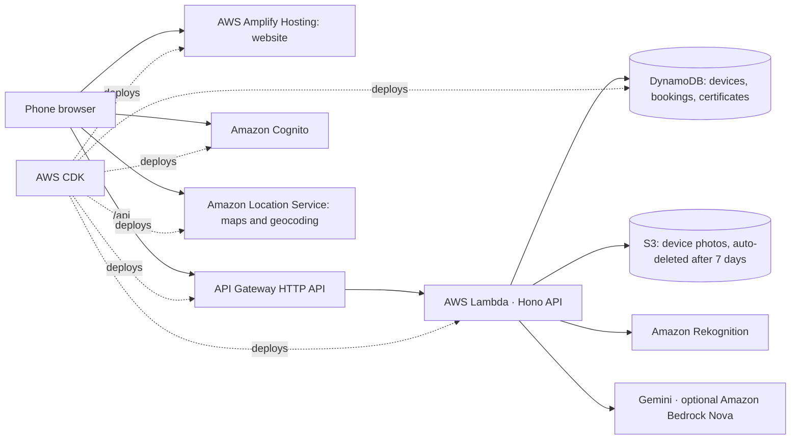

# SafeDrop eWaste

**Wipe it. Drop it. Done.** SafeDrop helps people in India empty the drawer of old phones, laptops and chargers safely. It shows how to wipe each device with official steps, finds a CPCB-registered recycler or refurbisher nearby, books a drop-off with a QR handover code, and issues a recycling certificate anyone can verify. The certificate shows the CO₂e avoided and the **energy saved** compared with mining new metals.

Track: **Waste and Energy** (E-waste · Recycling · Segregation · Informal recyclers)

- **Live app:** https://main.d2ykddnngohyy3.amplifyapp.com
- **Documentation (PDF):** [docs/SafeDrop-eWaste-Documentation.pdf](docs/SafeDrop-eWaste-Documentation.pdf)
- **Demo login:** `demo@example.com` / `SafeDrop@2026`. One account is a user, a drop-point partner and a kabadiwala pickup partner, so you can run the whole flow alone. Demo activity is labelled and kept out of the public impact totals.

---

## The problem

- India generated **1,397,955 tonnes** of e-waste in FY 2024-25 (CPCB, via [PIB, 11 Aug 2025](https://pib.gov.in/PressReleasePage.aspx?PRID=2155124)). Only **70.71%** was reported as collected and processed formally ([PIB, 24 Jul 2025](https://pib.gov.in/PressReleasePage.aspx?PRID=2147876)).
- In a survey of 1,039 young adults in New Delhi, **46.5% keep old phones at home** and only **3.8%** take them to a recycling centre ([Borthakur & Singh, 2022](https://pmc.ncbi.nlm.nih.gov/articles/PMC8853223/)).
- Of people who keep old phones, **26% worry about others accessing their data** and **19% don’t know how to wipe it** ([YouGov UK, 2024](https://yougov.com/en-gb/articles/50080-what-do-britons-do-with-their-old-phones-half-of-t)).
- Devices that do leave the house often end up with scrap dealers. WHO says open burning and heating are the most hazardous informal e-waste activities ([WHO, Oct 2024](https://www.who.int/news-room/fact-sheets/detail/electronic-waste-(e-waste))).

People hold on because they fear for their data and don’t know who will take a device safely. SafeDrop fixes both, and it brings informal collectors (kabadiwalas) into the formal chain instead of cutting them out.

## What it does: the 15 features

| # | Feature | What it does |
|---|---|---|
| 1 | AI device scan | Photo in; device type, brand and the matching wipe guide out |
| 2 | Swollen-battery check | Flags risky lithium batteries and shows how to carry them safely |
| 3 | 10 official wipe guides | 104 steps, each linked to Google, Apple, Samsung, Microsoft, WhatsApp or NIST pages |
| 4 | India privacy steps | UPI apps, WhatsApp backup, eSIM, Find My Device |
| 5 | Lock-out alerts | Critical steps (Google FRP, Apple Activation Lock) must be done before handover |
| 6 | Ask SafeDrop | An AI helper that answers in English or Hindi **only from the official steps**, with sources |
| 7 | Registered recycler map | All 419 CPCB-registered recyclers and 154 refurbishers, on Amazon Location Service maps |
| 8 | Nearest first | Sort by distance from your GPS location or pincode |
| 9 | “Is it registered?” check | Checks a collector’s company name against the CPCB list |
| 10 | Reuse first | Shows refurbishers for working devices (reuse saves about 8× more energy than recycling) |
| 11 | Drop-off or doorstep pickup | Carry devices to a drop point, or have a verified kabadiwala pickup partner collect them |
| 12 | QR handover code | A 6-character code that ties the wiped devices to the handover |
| 13 | Partner portals | Drop-point staff scan the QR, weigh and confirm; kabadiwala partners accept pickups and log collection with the customer’s code |
| 14 | Verifiable certificate | A public link and QR prove the devices reached a recycler |
| 15 | Waste → energy saved | Kg diverted, CO₂e avoided and kWh saved, from US EPA WARM v16 factors |

## Where AWS fits



| AWS service | Role in SafeDrop |
|---|---|
| **AWS Lambda** + **API Gateway** | The whole API: devices, wipe progress, bookings, partner handovers, certificates, AI endpoints |
| **Amazon DynamoDB** | Single-table store with two GSIs (by user; by drop point, pickup pincode or collector). Handovers are atomic `TransactWrite`s |
| **AWS Amplify Hosting** | Serves the website over HTTPS with SPA rewrites; `scripts/deploy.mjs` uploads each build as a manual deployment |
| **Amazon S3** | Device photos through presigned uploads, with a 7-day lifecycle rule for privacy |
| **Amazon Cognito** | Sign-up and sign-in; `partner` and `demo` groups and `custom:pointId` for drop-point staff |
| **Amazon Location Service** | Map tiles (India political view) and geocoding of all 573 CPCB addresses plus pincode search |
| **Amazon Rekognition** | Device recognition (labels plus brand text) whenever the vision model is unavailable |
| **Amazon Bedrock** (optional) | Nova Lite vision and the helper; switched on with `BEDROCK_ENABLED=true` |
| **AWS Budgets** | $5 monthly alert on the account |
| **AWS CDK** | Everything above is one TypeScript stack (`infra/lib/stack.ts`) |

## Real data only

Nothing in the app is synthetic.

- **Recyclers and refurbishers:** the CPCB E-Waste EPR portal registration-granted lists (downloaded 10 Oct 2026), geocoded with Amazon Location Service. Each pin records its precision: address, area, pincode or district. See `research/recyclers-README.md`.
- **Wipe steps:** official vendor pages and NIST SP 800-88 Rev. 2. See `research/wipe-guides.md`.
- **CO₂e:** US EPA WARM v16 Electronics chapter, Exhibit 1-5 (recycling compared with landfilling).
- **Energy:** US EPA WARM v16 Energy Impacts chapter, Exhibit 7-12, converted at 293.07107 kWh per million Btu (NIST SP 811).
- **Typical weights** (used only to prefill the partner’s scale form): UNU average weights per piece.
- **Phone metals:** USGS Fact Sheet 2006-3097.
- **Every statistic** shown in the app: `research/facts.md`.

## Run it locally

Requirements: Node 22+ and the AWS CLI with a profile for the target account.

```bash
npm install
node scripts/deploy.mjs     # builds, deploys the CDK stack, writes web/public/config.json and api/.env
node scripts/seed.mjs       # demo drop point, demo account and demo pickup partner
npm run dev:api             # http://localhost:8787/api/health
npm run dev:web             # http://localhost:5173
npm test                    # domain tests: codes, labels, guide matching, CO₂e and energy maths, citations
node scripts/e2e.mjs        # full journey against the deployed API (drop-off and kabadiwala pickup)
node scripts/reset-demo.mjs # clear the demo account's data
```

`api/.env` takes `GEMINI_API_KEY` for the vision model and helper (Gemini 3.x Flash models, rotated when one is busy). Set `BEDROCK_ENABLED=true` to use Amazon Bedrock Nova first. Pickup partners are approved after a verification call with `node scripts/approve-collector.mjs <email>`.

## Project layout

```
api/       Hono API for AWS Lambda (routes, DynamoDB access, AI chain, impact maths, tests)
web/       React + Vite + Tailwind site (white, golden yellow, sky blue)
infra/     AWS CDK stack
data/      Data built for the app (guides, impact factors, geocoded recyclers)
research/  Verified sources, parsing scripts and notes
scripts/   build-data, geocoding, deploy and seed scripts
```
