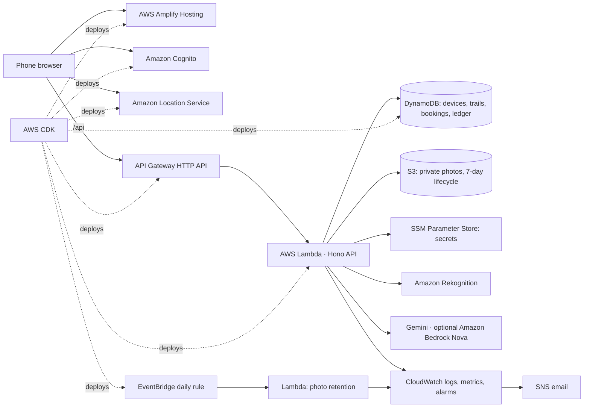

# SafeDrop eWaste

**Wipe it. Drop it. Done.** SafeDrop helps people in India empty the drawer of old phones, laptops and chargers safely. The owner follows a versioned wipe checklist and signs for it. They find a CPCB-registered recycler or refurbisher nearby and hand the device over at a drop point or to a verified kabadiwala using a single-use signed QR code. They get a hash-linked receipt that anyone can check. The impact ledger reports measured weight separately from the estimated CO₂e and **energy saved** compared with mining new metals.

Track: **Waste and Energy** (E-waste · Recycling · Segregation · Informal recyclers)

- **Live app:** https://main.d2ykddnngohyy3.amplifyapp.com
- **Documentation (PDF):** [docs/SafeDrop-eWaste-Documentation.pdf](docs/SafeDrop-eWaste-Documentation.pdf)
- **Demo login:** `demo@example.com` / `SafeDrop@2026`.
  - One account holds every role: owner, drop-point staff ("Partner"), kabadiwala, recycling facility ("Facility") and admin. You can run the whole journey alone.
  - Demo activity is labelled and kept out of the public impact totals.

---

## The problem

- India generated **1,397,955 tonnes** of e-waste in FY 2024-25 (CPCB, via [PIB, 11 Aug 2025](https://pib.gov.in/PressReleasePage.aspx?PRID=2155124)). Only **70.71%** was reported as collected and processed formally ([PIB, 24 Jul 2025](https://pib.gov.in/PressReleasePage.aspx?PRID=2147876)).
- In a survey of 1,039 young adults in New Delhi, **46.5% keep old phones at home** and only **3.8%** take them to a recycling centre ([Borthakur & Singh, 2022](https://pmc.ncbi.nlm.nih.gov/articles/PMC8853223/)).
- Of people who keep old phones, **26% worry about others accessing their data** and **19% don’t know how to wipe it** ([YouGov UK, 2024](https://yougov.com/en-gb/articles/50080-what-do-britons-do-with-their-old-phones-half-of-t)).
- Devices that do leave the house often end up with scrap dealers. WHO says open burning and heating are the most hazardous informal e-waste activities ([WHO, Oct 2024](https://www.who.int/news-room/fact-sheets/detail/electronic-waste-(e-waste))).

People hold on because they fear for their data and don’t know who will take a device safely. SafeDrop fixes both, and it brings informal collectors (kabadiwalas) into the formal chain instead of cutting them out.

## What it does: the 15 features

Every feature below is enforced by the backend and covered by a live test, not just shown on a page.

| # | Feature | What it does |
|---|---|---|
| 1 | AI device scan | Gemini vision suggests type, brand and guide; Amazon Rekognition is the fallback. Labelled a suggestion, never a diagnosis |
| 2 | Reuse-first advice | Five condition questions decide reuse, recycle or "not enough information". No guessing |
| 3 | Battery hazard stop | A swollen or leaking battery blocks ordinary drop-off and shows US EPA safe-handling steps |
| 4 | 10 versioned wipe guides | 104 steps from makers' own pages; each guide has a version and review date, and works offline once opened |
| 5 | Signed wipe record | Each step is done, doesn't apply or skipped. Critical steps can't be skipped. The owner signs an attestation that says what it does not prove |
| 6 | India privacy steps | UPI apps, WhatsApp backup, eSIM and Find My Device |
| 7 | Ask SafeDrop | Cited answers in English or Hindi from the official steps only, with rule-based buttons for the next safe step |
| 8 | Cleaned recycler map | 557 CPCB-listed sites (404 recyclers, 153 refurbishers), each with source, check date and location confidence |
| 9 | "Is it registered?" | A name check shows match confidence and says what a match does not prove |
| 10 | Drop-off or doorstep pickup | Hand over at a partner drop point, or to a verified kabadiwala who collects with your code |
| 11 | Single-use signed QR | HMAC-signed QR codes and hashed 6-character codes that expire and work once. Replays, forgeries and expired codes are refused and logged |
| 12 | Partner portal | Weigh each item in kg, correct a weight within 48 h with a reason, and dispatch to a CPCB-registered recycler |
| 13 | Processor confirmation | Only the receiving facility, with its own evidence, can mark items processed |
| 14 | Hash-linked receipt | Every step is a chained event, and the browser re-verifies the chain. The receipt lists what it proves and what it doesn't |
| 15 | Evidence-based impact | Collected, weighed and processor-confirmed are counted apart. CO₂e and kWh are labelled estimates, written exactly once per weigh event |

### How the journey is enforced

- **One lifecycle.** A device can only move `added → wiping → ready → booked → collected → received → dispatched → processed`. The server refuses any skip, any backwards move and any double confirmation, and returns `409`.
- **TrustChain.** Each move appends an event to the device's trail in the same DynamoDB transaction.
  - Each event stores the SHA-256 hash of the event before it, so editing, deleting or reordering any event breaks the chain.
  - The receipt page recomputes the chain in the browser with Web Crypto.
- **Safe retries.** Write endpoints accept an `Idempotency-Key`, so a flaky network can't create a second device, booking or handover.

## Where AWS fits

Each service has one job and a guardrail.



| AWS service | Its one job | Guardrail |
|---|---|---|
| **Lambda + API Gateway** | All business rules: lifecycle, handovers, dispatch, ledger, AI calls | Schema, role and ownership checks in every handler; stage throttling; preflights answered before auth |
| **DynamoDB** | Devices, trails, bookings, receipts, ledger, partners | Conditional writes and transactions for single-use codes and exactly-once impact; idempotency rows with TTL |
| **Cognito** | Sign-in; groups for partner, processor, admin and demo | Groups checked on the server; the web client can't write the `pointId` attribute |
| **S3** | Private device photos | Public access blocked, encryption, presigned POST with a 5 MB limit, 7-day lifecycle, Lambda limited to `photos/*` |
| **SSM Parameter Store** | Gemini key and QR signing secret | SecureString, written by the deploy script through the SDK; Lambda can read only these two parameters |
| **Amazon Location** | Map tiles (India political view) and geocoding | API key restricted to the site's domains; approximate pins labelled; never used as proof of registration |
| **EventBridge + Lambda** | Daily photo-retention check | Counts photos older than 8 days, deletes them and publishes metrics |
| **CloudWatch + SNS** | Structured logs, metric filters, a dashboard and four alarms by email | Logs carry event names and counts, never names, codes or tokens |
| **Rekognition** | Device recognition when the vision model is unavailable | Labelled as a fallback in the result |
| **Bedrock** (optional) | Nova Lite vision and the helper | Off until `BEDROCK_ENABLED=true` |
| **Amplify, Budgets, CDK** | Hosting, a $5 monthly alert, infrastructure as code | Every script refuses to run against any account but the hackathon one |

## Real data only

Nothing in the app is synthetic.

- **Recyclers and refurbishers:** the CPCB E-Waste EPR portal registration-granted lists (downloaded 10 Oct 2026), geocoded with Amazon Location Service.
  - The audit removed 2 test rows and 6 rows marked "operations disabled", merged repeat registrations of one site, and flagged 2 same-name cases for review. See `research/directory-audit.md`.
  - Each pin records its precision: address, area, pincode or district. See `research/recyclers-README.md`.
- **Wipe steps:** official vendor pages and NIST SP 800-88 Rev. 2. See `research/wipe-guides.md`.
- **CO₂e:** US EPA WARM v16 Electronics chapter, Exhibit 1-5 (recycling compared with landfilling).
- **Energy:** US EPA WARM v16 Energy Impacts chapter, Exhibit 7-12, converted at 293.07107 kWh per million Btu (NIST SP 811).
- **Typical weights** (used only to prefill the partner's scale form): UNU average weights per piece.
- **Phone metals:** USGS Fact Sheet 2006-3097.
- **Every statistic** shown in the app: `research/facts.md`.

## Run it locally

Requirements: Node 22+ and the AWS CLI with a profile for the target account.

```bash
npm install
node scripts/deploy.mjs          # builds, stores secrets in SSM, deploys the CDK stack and the site, writes api/.env
node scripts/seed.mjs            # demo drop point, demo facility, demo account and demo pickup partner
npm run dev:api                  # http://localhost:8787/api/health
npm run dev:web                  # http://localhost:5173
npm test                         # 16 unit tests: lifecycle, hash chain, QR signing, routing, helper actions, impact maths
node scripts/e2e.mjs             # 16 live checks against the deployed API, including replay, forgery and double-scan attacks
node scripts/reset-demo.mjs      # clear the demo account's data (--deep also sweeps orphaned demo rows)
```

`api/.env` takes `GEMINI_API_KEY` for the vision model and helper (Gemini 3.x Flash models, rotated when one is busy). The deploy script copies the key into SSM, and the deployed Lambda reads it from there. Set `BEDROCK_ENABLED=true` to use Amazon Bedrock Nova first. Pickup partners are approved after a verification call with `node scripts/approve-collector.mjs <email>`.

## Project layout

```
api/       Hono API for AWS Lambda (routes, lifecycle, trail, DynamoDB access, AI chain, impact maths, tests)
web/       React + Vite + Tailwind site (white, golden yellow, sky blue)
infra/     AWS CDK stack
data/      Data built for the app (guides, impact factors, audited recycler directory)
research/  Verified sources, parsing scripts and notes
scripts/   build-data, geocoding, deploy, seed, reset and end-to-end scripts
docs/      Documentation PDF
```
